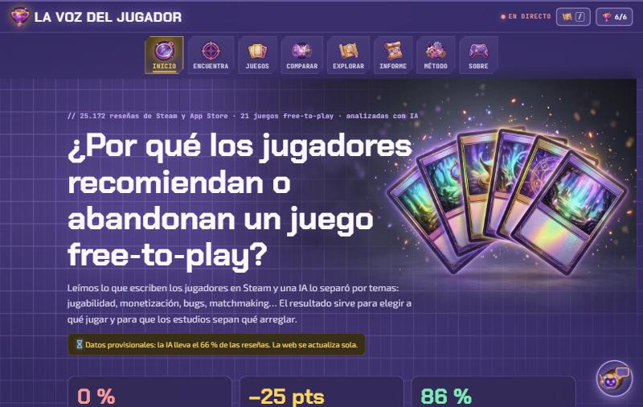
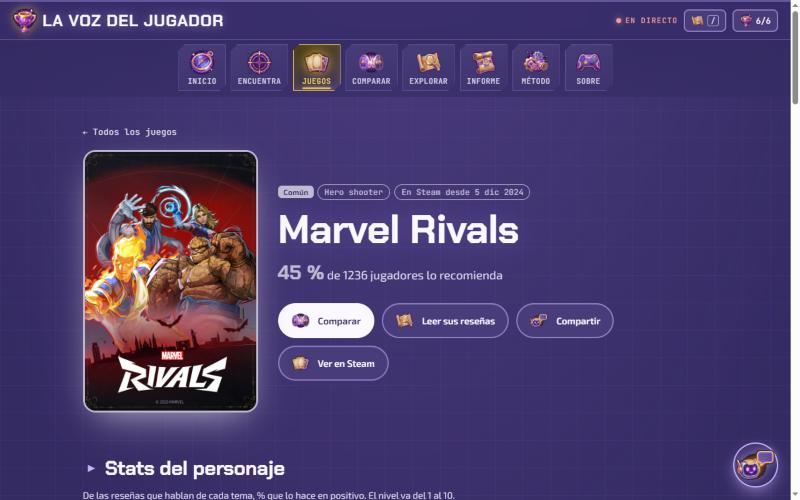
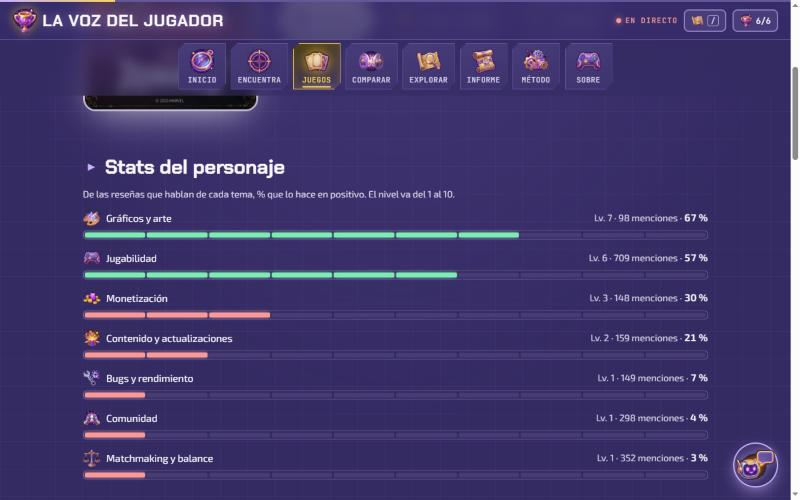
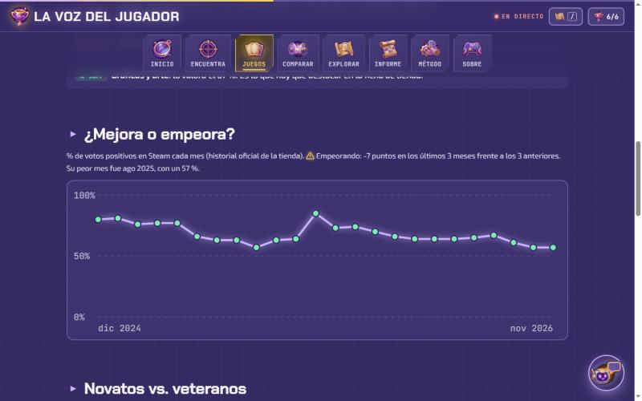
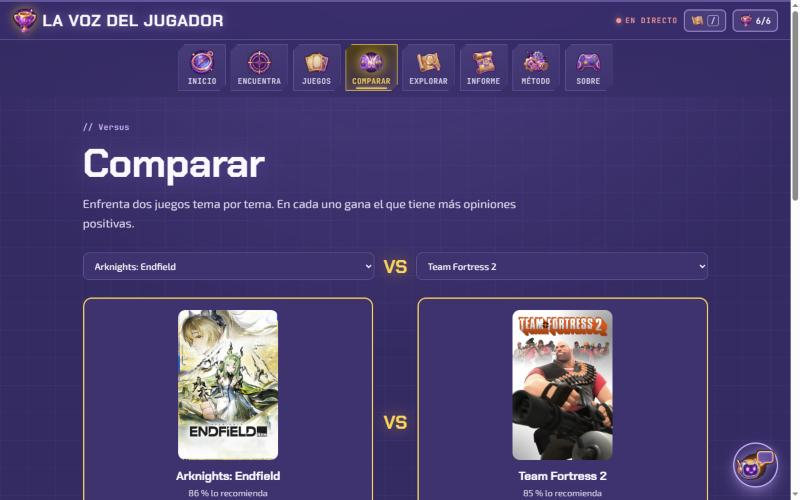

# La voz del jugador

**¿Por qué los jugadores recomiendan o abandonan un juego free-to-play?**
Más de 44.000 reseñas de Steam y la App Store de 35 juegos gratuitos, clasificadas con IA por temas (jugabilidad, monetización, bugs, matchmaking…) y convertidas en una web pensada para jugadores y para estudios.

### 👉 [Ver la web en directo](https://ignacioegea.github.io/voz-del-jugador/)



## Hallazgos clave

*Datos de noviembre de 2026: 44.510 reseñas de 35 juegos.*

1. **El juego gusta; lo que falla es lo de alrededor.** La jugabilidad es el tema del que más se habla (27.625 reseñas) y solo el 25 % lo critica. En cambio, cuando alguien menciona el **matchmaking o el balance**, el 88 % es para quejarse; con los **bugs y el rendimiento**, el 85 %; con la **comunidad**, el 76 %.
2. **La monetización no tiene por qué ser odiada.** En Clash Royale solo el 3 % habla bien de ella y en Genshin Impact, el 5 %. En Warframe, el 70 %: se puede cobrar sin enfadar a los jugadores.
3. **Los veteranos se queman.** En Marvel Rivals lo recomienda el 61 % de los novatos (menos de 10 h), pero solo el 36 % de los veteranos (100 h o más). Pasa en 10 de los 28 juegos con horas registradas.
4. **Mucha diferencia entre juegos.** De media lo recomienda el 60 %, pero va del 86 % de Arknights: Endfield al 27 % de Honor of Kings.

**Recomendaciones para un estudio F2P**
- Antes de añadir contenido, **arreglar el matchmaking y los bugs**: son las quejas más duras. La consulta [`06_prioridades_estudio.sql`](sql/06_prioridades_estudio.sql) ordena, juego a juego, qué tema le quita más recomendaciones.
- **Tomar como referencia a Warframe** para monetizar: se puede cobrar dejando contentos a los jugadores.
- **Vigilar a los veteranos**, no solo la captación: son los jugadores más fieles y, en algunos juegos, los menos contentos.

## Qué puedes hacer en la web

| | |
|---|---|
|  | **Ficha de cada juego** como una carta coleccionable: % de jugadores que lo recomiendan, rareza, fecha de salida y enlace a su tienda. |
|  | **Stats del personaje**: qué % habla bien de cada tema, en barras de 10 niveles, con aviso cuando hay pocos datos. Además, *patch notes* con lo que arreglaría un estudio y la diferencia entre novatos y veteranos. |
|  | **¿Mejora o empeora?**: la valoración mes a mes según el historial oficial de Steam, con el mes más bajo marcado. |
|  | **Comparar**: dos juegos frente a frente, tema por tema, con un veredicto escrito de quién gana y por qué. |

También tiene un buscador de juego según lo que te importa, un explorador de reseñas traducidas, conclusiones generales, un asistente de chat, logros, una pantalla para **validar a mano la IA** y versión para móvil.

## Cómo funciona

```
Steam API + RSS App Store ──► descargar.py / descargar_appstore.py ──► limpiar.py
        ──► clasificar.py (Gemini, en tandas) ──► traducir.py ──► resumir.py ──► web/ (GitHub Pages)
                                                               └──► base_datos.py (SQLite + SQL) ──► CSV
```

1. **Datos:** reseñas recientes en inglés desde la API oficial de Steam y el RSS público de la App Store (sin scraping).
2. **Limpieza:** pandas quita duplicados, spam y textos vacíos, y agrupa a cada jugador por horas jugadas (novato, medio, veterano).
3. **IA:** Gemini lee cada reseña y marca qué opina de 7 temas (positivo, negativo o neutro) con un prompt fijo y temperatura 0.
4. **Automatización:** GitHub Actions clasifica en tandas de 14 minutos con la cuota gratuita, guarda el avance y vuelve a publicar la web sola.
5. **Web:** HTML, CSS y JavaScript sin frameworks, que lee un `data.json` generado por Python.
6. **SQL:** `base_datos.py` guarda todo en una base **SQLite** con 5 tablas relacionadas (juegos, reseñas, temas de la IA, historial mensual y actualizaciones) y ejecuta las consultas de `sql/`.

## Análisis en SQL

| Consulta | Pregunta de negocio |
|---|---|
| [`01_resumen_por_juego`](sql/01_resumen_por_juego.sql) | ¿Cuántas reseñas tiene cada juego y qué % lo recomienda? |
| [`02_positivas_por_mes`](sql/02_positivas_por_mes.sql) | ¿Cómo evoluciona la valoración mes a mes? |
| [`03_horas_vs_recomendacion`](sql/03_horas_vs_recomendacion.sql) | ¿Recomiendan más los novatos o los veteranos? |
| [`04_temas_en_negativas`](sql/04_temas_en_negativas.sql) | ¿De qué se quejan las reseñas negativas? |
| [`05_tras_actualizaciones`](sql/05_tras_actualizaciones.sql) | ¿Sube o baja la valoración después de un parche? |
| [`06_prioridades_estudio`](sql/06_prioridades_estudio.sql) | ¿Qué debería arreglar primero cada estudio? |
| [`07_sentimiento_por_tema`](sql/07_sentimiento_por_tema.sql) | ¿Qué % habla bien o mal de cada tema? |

Cada consulta se exporta como CSV al publicar la web (en `web/datos/`, junto a la base `voz.db`), listo para abrirlo en Excel, Looker Studio o Power BI.

## Calidad y límites

- **Validación:** 200 reseñas al azar (semilla 42) se etiquetan a mano en la web (`#/validar`) y `src/validar.py` calcula el % de acierto de la IA por tema.
- Con **menos de 30 menciones**, un tema se marca como «pocos datos» y no se usa para titulares.
- Solo reseñas en inglés y recientes: es una foto del momento, no la historia del juego (para eso está el historial de Steam).
- La App Store no da horas jugadas ni historial mensual, así que los 7 juegos de móvil (Genshin, Honkai, Honor of Kings, Brawl Stars, Clash Royale, PUBG MOBILE y Pokémon TCG Pocket) no tienen esas secciones.

## Estructura

| Carpeta | Qué hay |
|---|---|
| `src/` | Scripts de Python: descarga, limpieza, clasificación, traducción, validación y resumen |
| `data/` | Reseñas limpias, clasificaciones de la IA y muestra de validación |
| `sql/` | Consultas SQL de análisis sobre la base SQLite |
| `notebooks/` | Exploración inicial de los datos |
| `web/` | La web estática que se publica en GitHub Pages |
| `.github/workflows/` | Las automatizaciones: descargar, clasificar, traducir y publicar |
| `DIARIO_DECISIONES.md` | Cada decisión del proyecto y por qué se tomó |

## Ejecutarlo en local

```bash
pip install -r requirements.txt
echo "GEMINI_API_KEY=tu_clave" > .env      # clave gratuita de Google AI Studio
python src/descargar.py && python src/limpiar.py
python src/clasificar.py && python src/resumir.py && python src/base_datos.py
python -m http.server -d web               # y abre http://localhost:8000
```

## Autor

**Ignacio Egea Villalba**: Diseño de Productos Interactivos (U-tad) y Máster en Big Data, Data Science y Business Analytics (UCM).
Este proyecto continúa mi [TFG sobre la evolución de los videojuegos free-to-play](web/TFG_F2P_Ignacio_Egea.pdf).

*Proyecto sin ánimo de lucro, sin relación con Valve, Apple ni los estudios. Las portadas son de sus respectivos dueños y se cargan directamente desde las tiendas.*
